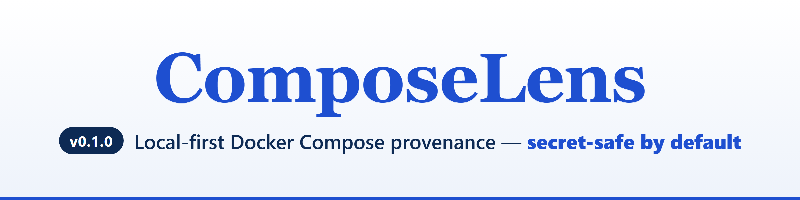
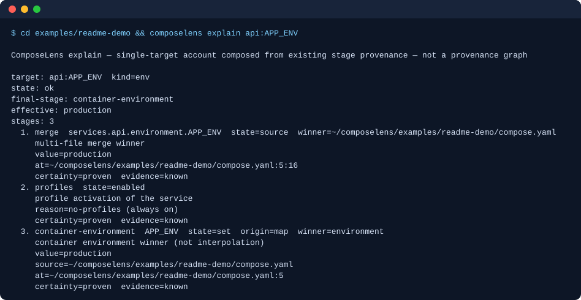
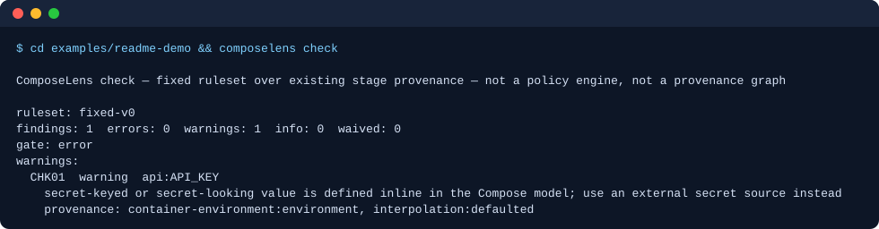
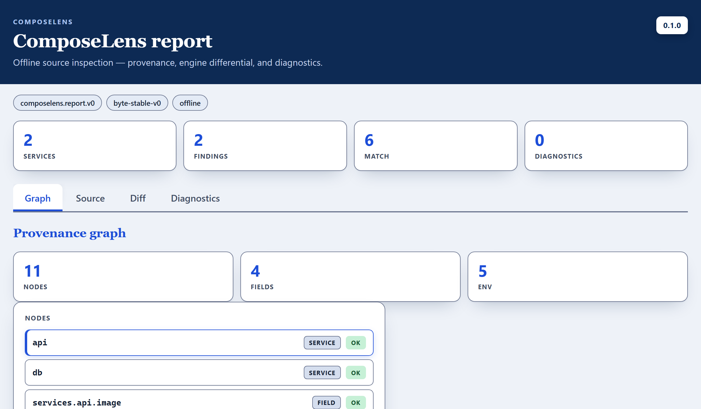

<p align="center">
  
</p>

<p align="center">
  <a href="LICENSE"></a>
  
  
  
  
</p>

**ComposeLens** shows **where each effective Docker Compose value comes from** — what won, from which file and line, what it shadowed, and how to reproduce it — **secret-safe by default**.

It is an explanation tool, **not** an alternate Compose engine. Official `docker compose` is the authority; ComposeLens never invents a value.

---

## See what wins

**`explain`** names the winning file, line, and stage — and what it overrode:

<p align="center"></p>

**`check`** flags risky patterns over a fixed ruleset — and never prints a secret:

<p align="center"></p>

**`report --html`** writes one self-contained, **offline** dashboard — system fonts only, CSP-hardened, WCAG&nbsp;2.1&nbsp;AA:

<p align="center"></p>

> The demo project is shipped as `examples/readme-demo` (two services). `.env` sets `APP_ENV=staging`, but `compose.yaml` sets `APP_ENV: production` in `environment:` — so `production` wins and the `.env` value is collected as an interpolation source, **not** injected: `explain api:APP_ENV` shows no container-environment loser, and `check` reports one finding, `CHK01` (the `API_KEY` inline default), with the value redacted. The two terminal images are rendered from exactly that output (`TestReadmeTerminalImagesMatchTheDemo` re-renders them and fails if they drift; the checkout path is shown as `~/composelens`). Run the commands in `examples/readme-demo/README.md` to reproduce it.

---

## Commands

| Command | What it does |
| --- | --- |
| `version` | Stable identity JSON (`composelens.version.v0`, name `composelens`, version `0.1.0`). |
| `doctor` | Platform, whether `docker compose` is detectable (version string only; **no** render), inputs, capabilities. JSON `support: "recognized"` means **recognized Compose v2+ family**, not a verified multi-version matrix. `doctor --bundle` writes a **telemetry-free** local diagnostic file (no project source values). |
| `inspect` | **Source-level view — not resolved provenance.** Files, services + YAML locations, collected env sources, interpolation, include, extends, merge, profiles, container environment, canonical dual-form fields. |
| `explain` / `--all` | One target’s ordered stage chain, or the whole-model provenance graph with shadow-chains. Not a new resolver. |
| `diff` | Effective-config delta between two profile / env-file selections over the **same** files. Not an engine differential. |
| `check` | Fixed ruleset (CHK01–CHK06) as human, JSON, local SARIF 2.1.0, or `--github` annotations. Optional `--policy` overlay. Remaining `error` findings exit `6`; clean or below-gate exit `0`. Not a general policy engine. SARIF is **not** uploaded. `--github` is local log text, not a GitHub API call. |
| `differential` | Internal model vs live `docker compose config`. Findings stay honest; stages are not changed to force agreement. Does not require the daemon. A remote include skips the capture unless `--allow-network`. |
| `reproduce` | Prints the `docker compose … config` command (files and flags only) that recreates the modeled selection. Does not execute it. |
| `report --json` / `--html` | Self-contained `composelens.report.v0` package, or one **offline CSP-hardened HTML** file with four keyboard-navigable, WCAG 2.1 AA-structured views **compiled into the binary**. Human `report` is reserved (exit `5`). Runs local `docker compose config` for its differential section; `--no-engine` runs no Docker command, and a remote include skips the capture unless `--allow-network`. |

**Network boundary:** ComposeLens itself makes no network calls. Local `docker compose config` (run by `differential` and `report`) needs none for a local project; a remote include (`oci://`, Git, `http(s)://`) needs `--allow-network`, and `report --no-engine` runs no Docker command.

`--env-file` **replaces** project `.env` for interpolation (not an overlay). Interpolation and container environment are distinct stages. Nested defaults and `.env` values are interpolated as Compose does.

`explain` without a target and without `--all` is usage (exit `2`). `--json` with `--sarif`, or `--json` with `--html`, is usage (exit `2`).

## 60-second quickstart

Requires **Go 1.27.3** (see `docs/quickstart.md`) and a checkout of this repository. No ComposeLens network service. After modules are in the local cache, `GOPROXY=off` is enough.

From the **repository root** (Windows; Unix: `go build -o composelens` and `./composelens`):

```bash
go build -o composelens.exe ./cmd/composelens

.\composelens.exe version --json
.\composelens.exe doctor --json --project-directory examples/precedence-lab
.\composelens.exe inspect --json --project-directory examples/precedence-lab
.\composelens.exe explain web:APP_ENV --project-directory examples/precedence-lab
.\composelens.exe check --json --project-directory examples/precedence-lab
.\composelens.exe report --html --project-directory examples/precedence-lab > report.html
```

You can copy `examples/precedence-lab` into an empty folder and pass that folder as `--project-directory`; only the binary plus those files are required.

Alternatively, after building at the repository root, `cd examples/precedence-lab` and run `../../composelens.exe` (Unix: `../../composelens`). Do not use `../composelens`.

Tests and lint: `docs/quickstart.md`.

## What it is

Local-first Compose **source inspection**: discovery, parse with file+line, interpolation, include, extends, merge, profiles, container-environment precedence, canonical dual-form fields, a fixed check ruleset, an engine differential, a reproduction command, and an offline HTML report in the CLI binary. Redaction is on by default; optional `--redact` overlays extra patterns (`docs/redact.md`).

A composite GitHub Action interface exists (`action.yml`). `.github/workflows/example-composelens.yml` checks `examples/readme-demo` in this repository. When adapting it for your repository, set `project-directory` to the folder containing your Compose project. Adoption examples: `docs/examples.md`.

## What it is not

- An alternate Compose engine, a general policy engine, or a new resolver
- SARIF **upload** / GitHub code-scanning, or a GitHub Marketplace listing
- Applying include `env_file` / `project_directory`, string short-form `extends`, Dockerfile `ENV`, `docker compose run -e`, or profiles on non-service objects
- Comparing two different Compose file sets (`docs/diff.md`)
- A verified multi-version Compose **matrix** (corpus values were recorded with Docker Compose **v5.4.0** / Engine **29.7.2**; `docs/compatibility.md`)
- Signed GitHub Release binaries or cross-builds

## Status

Product version **0.1.0**. Local-first developer tool. Licence: Apache-2.0 (see `LICENSE` and `NOTICE`).

Support is **telemetry-free**: nothing is sent anywhere (`docs/support.md`, `docs/privacy.md`).

Workflows under `.github/workflows/` (CI on Linux, macOS and Windows, plus security scans) are provided so you can enable them in your repository (`docs/security-automation.md`).

## Docs

`docs/cli.md` · `docs/quickstart.md` · `docs/privacy.md` · `docs/explain.md` · `docs/graph.md` · `docs/check.md` · `docs/report.md` · `docs/differential.md` · `docs/reproduction.md` · `docs/compatibility.md`

Further: `docs/interpolation.md`, `docs/merge.md`, `docs/profiles.md`, `docs/include.md`, `docs/extends.md`, `docs/containerenv.md`, `docs/normalize.md`, `docs/policy.md`, `docs/redact.md`, `docs/diagnostics.md`, `docs/distribution.md`, `docs/github-action.md`, `docs/examples.md`, `docs/support.md`, `docs/fixtures.md`, `docs/corpus.md`, `docs/security-corpus.md`, `docs/engineadapter.md`, `docs/enginecap.md`, `docs/evidence-model.md`.
